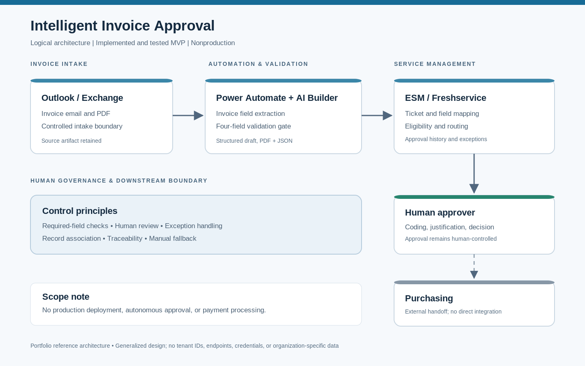
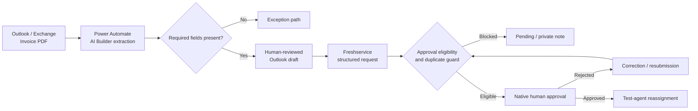

# Intelligent Invoice Approval

**AI-assisted invoice processing with human-governed financial approvals**

**Status:** Implemented and tested minimum viable product (MVP) in a limited, nonproduction environment. Not approved for production use.

## Overview

Invoice approval often requires staff to re-enter invoice details, request coding and justification, manage approvals through email, and reconcile supporting documents. This reference implementation explores a more structured workflow while retaining human review and financial decision-making.

The demonstrated technology stack is **Microsoft Outlook/Exchange, Power Automate, AI Builder, and Freshservice**. The workflow is modular in concept; replacing components with another mail service, orchestration engine, extraction service, or enterprise service management (ESM) platform would require new integration work and validation.

## Demonstrated MVP capabilities

- Receives invoice emails and processes PDF attachments using Power Automate and AI Builder.
- Extracts invoice fields and checks for four required values before preparing the normal review path.
- Prepares a structured Outlook draft for human review, with invoice information and supporting attachments.
- Creates a structured Freshservice request through configured email intake and field mapping.
- Checks required approval fields and a demonstration department-code rule before initiating native approval.
- Supports a designated human approver, approval or rejection, activity history, correction and resubmission, and a duplicate approval-request guard.
- Demonstrates postapproval reassignment to a **test agent**; it does not implement a live Purchasing handoff.

Financial coding values used in the demonstration are fixed test defaults, **not** automatically inferred or verified accounting classifications. The MVP does not autonomously authorize payments.

## Architecture

See [implementation details](docs/implementation.md) for module boundaries and portability considerations.

## Evidence and documentation

| Document | Purpose |
|---|---|
| [Implementation and architecture](docs/implementation.md) | Reference workflow, integration boundaries, controls and adaptations |
| [Validation and limitations](docs/validation.md) | Reported test evidence, known defects, and unverified production requirements |

This public portfolio intentionally contains **documentation only**. Environment-specific exports, connection details, organizational identifiers, invoice records, and internal screenshots are excluded.

## Security and governance

The MVP uses synthetic test invoices, human review before ESM submission, human financial approval, validation checks, and native request history. These are limited demonstration controls, not a completed security assessment. Before operational use, an adopting organization would need to evaluate identity and access management, data handling and retention, connector permissions, untrusted invoice content, audit requirements, exception ownership, and Finance-approved business controls.

## Scope and production readiness

**Not demonstrated:** production deployment; Finance user acceptance; live Purchasing or accounting integration; automated payment; comprehensive security or reliability testing; end-to-end approval cycle-time improvement; cost savings; generalized duplicate-invoice detection; or autonomous financial approval.

A production adoption would require workflow ownership, validated accounting mappings, approved integration and access design, operational monitoring and support, Finance acceptance, and testing with representative authorized data.

## Project maturity

This is a documented, limited-scope reference implementation intended to illustrate a maintainable approach to invoice intake and approval coordination. Its results support MVP feasibility under the recorded test conditions, not claims of enterprise readiness or business impact.
